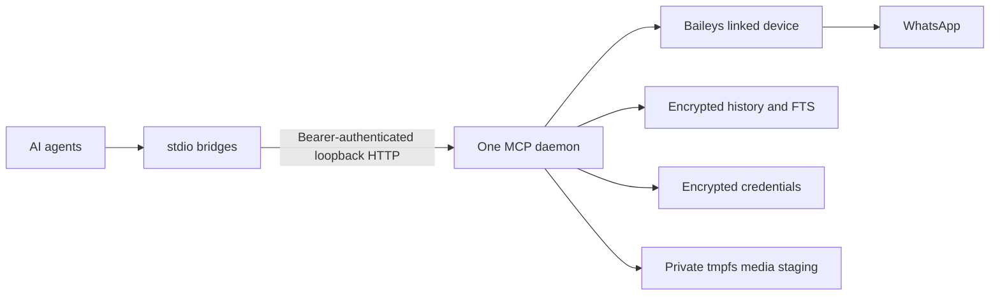

# WhatsApp MCP — Self-hosted WhatsApp tools for AI agents

Connect **Codex, Claude Desktop, Cursor, Antigravity, and other Model Context Protocol clients** to your own WhatsApp account. Search chat history, look up contacts, send messages and attachments, and retrieve media through one shared local daemon.

**Your account. Your machine. Encrypted message storage.** No project-operated cloud service or developer API key. Your chosen AI provider may receive messages retrieved by your agent.

[Quick start](#quick-start-linux) · [Connect your agent](#connect-your-agent) · [Tools](#available-tools) · [Security](SECURITY.md) · [Troubleshooting](#troubleshooting)

> Experimental, unofficial WhatsApp linked-device integration built on Baileys. Not affiliated with WhatsApp or Meta. Linking can fail or be revoked; this is not a guaranteed-uptime replacement for an official messaging API. Use responsibly and obtain recipients' consent. This release is tested on Linux; Windows/macOS users need a Linux VM and a local MCP client inside that VM.

## What you can do

- Search locally stored messages with SQLite FTS5, chat/date filters, and pagination.
- Read history while WhatsApp is offline.
- Send text, PDF documents, images, video, audio, and voice notes.
- Inspect send operations and available delivery/read receipts.
- Connect several agents to the **same** linked-device connection.
- Keep credentials, history, and full-text indexes in encrypted SQLite databases.

Example requests to your agent:

> “Find messages about tomorrow's meeting in my project group.”
>
> “Show me the last 10 messages from this contact.”
>
> “Send this PDF to the recipient I confirm. Check its operation status afterward.”

History includes messages this linked device receives; complete past history is not guaranteed. Old exports without media keys cannot recover attachments.

## Quick start (Linux)

Requirements: **Node.js 24.22.x**, npm, Git, and a phone with WhatsApp. Install FFmpeg/ffprobe for voice-note conversion. Use encrypted swap or disable swap, and use full-disk encryption for keys, application logs, and exported files.

```bash
git clone https://github.com/Dyfintie/whatsapp-mcp.git
cd whatsapp-mcp
npm ci
npm run setup
npm run daemon
```

Keep that terminal running. `npm ci` builds TypeScript through the package's prepare script. If your npm installation blocks dependency install scripts, review its policy before allowing required native dependencies. Do not run the service as root.

Setup generates random secrets with owner-only permissions. It is safe to repeat: existing keys are not overwritten. The default private directory is `~/.whatsapp-mcp-public`. The daemon listens on `127.0.0.1:8787`; it cannot bind to a public interface. Choose another port with `WHATSAPP_HTTP_PORT=8788 npm run daemon` if 8787 is already occupied, and configure the bridge's `WHATSAPP_MCP_URL` accordingly.

**Back up `database.key` securely and separately from database backups.** Losing it loses access to stored history and credentials. A copy of both the database and its key defeats encryption. Never commit the state directory or keys.

### Link your phone

After configuring an agent below, ask it:

> “Check WhatsApp status, then request a pairing code for my own number, including country code, without + or spaces.”

The agent uses `whatsapp_request_pairing_code`. On your phone, open WhatsApp → Linked devices → Link a device → Link with phone number, then enter the returned code. Menu wording can vary. A code must belong to the current attempt; do not request several competing codes. Ask the agent to check `whatsapp_get_status` again. Linking is successful only when it reports `connected`.

Use `whatsapp_relink` only when you intend to replace the local linked-device credentials. A normal daemon restart preserves them.

## Connect your agent

All configurations below launch a **stdio bridge**, which connects to the already-running authenticated local daemon. They do not start a second WhatsApp socket. Replace `/absolute/path/whatsapp-mcp` with the cloned directory and use an absolute Node executable if your GUI client does not inherit PATH.

### Codex

Add to `~/.codex/config.toml`:

```toml
[mcp_servers.whatsapp]
command = "node"
args = ["/absolute/path/whatsapp-mcp/scripts/run.mjs"]
startup_timeout_sec = 30
tool_timeout_sec = 120
```

Restart/reload your Codex session and inspect its MCP tool list. See the [official Codex MCP configuration guide](https://learn.chatgpt.com/docs/extend/mcp).

### Claude Desktop, Cursor, Antigravity and compatible clients

Add this server entry to your client's MCP configuration:

```json
{
  "mcpServers": {
    "whatsapp": {
      "command": "node",
      "args": ["/absolute/path/whatsapp-mcp/scripts/run.mjs"]
    }
  }
}
```

The settings location and reload action vary by client. For a custom state directory, add `"env": {"WHATSAPP_STATE_DIR": "/absolute/private/state"}` inside the server entry and use the same directory when running setup and the daemon. The bridge needs the API token file; it does not open or decrypt the message database.

### Direct HTTP clients

Streamable HTTP MCP is available at `http://127.0.0.1:8787/mcp`. Every request requires `Authorization: Bearer <contents-of-api-token-file>`, including health and transfer requests. Session IDs are not credentials. Prefer the bridge so tokens never appear in agent configuration or shell history. Do not expose this endpoint through a public tunnel or reverse proxy: this is a single-user local service, not an OAuth-protected remote MCP service.

## Sending attachments

Stage files in `/dev/shm/whatsapp-mcp-$(id -u)/uploads/`, then give the agent that absolute path. Files elsewhere, symlink escapes, and hard links are rejected. The authenticated `/upload` endpoint is another staging option. Downloads are restricted to the dedicated transfer directory.

Media staging uses Linux **tmpfs**, not encrypted persistent files. It is readable by the running process and may enter swap; encrypted swap/full-disk encryption is your responsibility. Media disappears on reboot; delete staged files when finished. Database envelopes remain encrypted and can sometimes download media again while WhatsApp still retains it.

Outgoing messages always identify the assistant: the first three reserved sends to a recipient use a full Auto attribution, later sends use `~By Auto`. Failed reservations may consume a slot. Supply a unique `request_id` for each intentional send. Reusing the same ID and content returns the original operation; changed content is rejected. An uncertain send must be reconciled, not blindly repeated.

## Available tools

| Tool | Purpose |
| --- | --- |
| `whatsapp_get_status` | Connection/pairing status |
| `whatsapp_get_diagnostics` | Sanitized connection diagnostics |
| `whatsapp_request_pairing_code` | Start phone-code pairing |
| `whatsapp_relink` | Explicitly replace local credentials |
| `whatsapp_list_chats` | Paginated stored conversations |
| `whatsapp_list_messages` | Stored messages with chat/date filters |
| `whatsapp_search_messages` | FTS5 keyword/phrase search |
| `whatsapp_get_message` | Individual message and receipt evidence |
| `whatsapp_lookup_contact` | Contact name or identifier lookup |
| `whatsapp_get_operation` | Durable send status by request ID |
| `whatsapp_send_message` | Attributed text send |
| `whatsapp_send_file` | Staged document/media send |
| `whatsapp_get_group_info` | Live group metadata |
| `whatsapp_download_media` | Download up to 50 MiB |
| `whatsapp_get_media` | Inline media up to 4 MiB |

`submitted` and `acknowledged` do not prove delivery. `delivered`/`read` need receipt evidence; group receipts may represent only one participant. A JID is a WhatsApp address, such as `15555550100@s.whatsapp.net`; opaque `@lid` identifiers must never be interpreted as phone numbers.

## Architecture



Database encryption uses SQLite3 Multiple Ciphers in SQLCipher-4-compatible mode. Migration/relink backups use AES-256-GCM with a random nonce. Keys are local files, not sent to the project maintainers. This is not an independent security certification; read the [threat model and limitations](SECURITY.md).

## Configuration

| Variable | Default / purpose |
| --- | --- |
| `WHATSAPP_STATE_DIR` | `~/.whatsapp-mcp-public` via launcher |
| `WHATSAPP_DB_KEY_FILE` | `database.key` under state directory |
| `WHATSAPP_API_TOKEN_FILE` | `api-token` under state directory |
| `WHATSAPP_HTTP_PORT` | `8787` |
| `WHATSAPP_MCP_URL` | `http://127.0.0.1:8787/mcp` for bridge |
| `WHATSAPP_TRANSFER_DIR` | `/dev/shm/whatsapp-mcp-UID`; must be tmpfs |
| `WHATSAPP_OFFLINE` | `true` disables WhatsApp network startup for testing |

Use the documented launcher. Direct `dist/index.js` invocation is a low-level interface that requires explicit credential paths. Never point this release at an existing plaintext personal database: implicit plaintext conversion/import is unsupported. Start with fresh encrypted state and link your account.

## Troubleshooting

- **Connection refused:** run `npm run daemon`; match its port and the bridge URL.
- **401 unauthorized:** daemon and bridge must use the same API-token file. Restart both after rotating it.
- **Cannot unlock database:** check the key path and permissions. Do not delete the database or regenerate its key.
- **Disconnected / reconnect exhausted:** inspect diagnostics; a normal restart can retry transient failures. A logged-out device needs explicit relinking.
- **Unknown send:** inspect `whatsapp_get_operation` with the original request ID. Do not create another send automatically.
- **File forbidden:** copy the file into uploads. A symlink is not a permitted substitute.
- **No old messages:** a linked device receives limited available history; the project cannot promise complete account export.

## Development and verification

```bash
npm run build
npm test
npm audit
```

Tests use isolated synthetic fixtures and do not send real WhatsApp messages. They cover lifecycle failures, idempotency, migration, FTS, media typing, HTTP sessions, token authentication, encrypted storage, and path restrictions. Live compatibility is a separate check requiring your own linked account.

Contributions welcome through issues and pull requests. Never attach private logs, phone numbers, pairing codes, databases, or credentials. Report vulnerabilities through [private security reporting](https://github.com/Dyfintie/whatsapp-mcp/security/advisories/new).

## License and attribution

MIT. Derived from [ydmw74/whatsapp-mcp-server](https://github.com/ydmw74/whatsapp-mcp-server); the original copyright notice is retained in [LICENSE](LICENSE). Uses [Baileys](https://github.com/WhiskeySockets/Baileys), the MCP TypeScript SDK, and [SQLite3 Multiple Ciphers](https://github.com/utelle/SQLite3MultipleCiphers).
