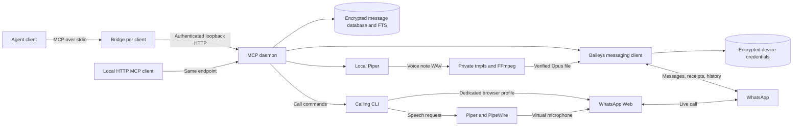

# High-level design

WhatsApp MCP lets several local agent clients use one linked WhatsApp account. A long-running daemon owns the messaging connection, credentials and history. Closing an agent ends its MCP session while the daemon can continue receiving messages. A second, optional linked device handles browser calls.

## Responsibilities and failure boundaries

| Component | Owns | What a failure looks like |
| --- | --- | --- |
| Stdio bridge | One agent-facing MCP server and an authenticated HTTP client session | A dropped or expired session can interrupt that agent. The bridge can initialize a new session. Tool calls with uncertain effects require inspection. |
| HTTP daemon | Loopback listener, token checks, MCP sessions, shared tool handlers and transfer endpoints | If the process exits, every bridge loses service. The operating system releases its database lock, allowing a new daemon to take ownership. |
| Baileys client | Messaging socket, pairing, reconnect attempts, sends and incoming protocol events | Search still works while disconnected. Sending and live group lookups require a verified connection. |
| Message and authentication stores | Encrypted history, FTS, operation and receipt evidence in one database, linked-device credentials in another | A missing or incorrect database key prevents opening encrypted data. An ingestion failure stops the socket and appears in diagnostics. |
| Calling helper | Browser controls for dialing, checking status, speaking and hanging up | Its browser can need a separate login even while messaging works. A WhatsApp Web UI change can prevent verification of the target or call state. |
| Local audio tools | Piper synthesis, FFmpeg conversion for notes, PipeWire routing for calls | A missing model can prevent synthesized speech. Ordinary text and local history use neither Piper nor the calling browser. |

A lightweight SQLite lock grants one process exclusive ownership **per state directory**. This prevents two local daemon instances from writing the same auth state. A state directory belongs to one account. Relinking replaces messaging credentials and retains its history. Use a separate state directory for a different account. Per-agent bridges share a daemon through independent MCP sessions. The shared API token grants the same tools to every authorized client. The agent or its operator handles human approval. [Daemon startup](../src/index.ts) · [Process lock](../src/services/process-lock.ts) · [Bridge](../src/bridge.ts)

## Where information lives

| Asset | Default location with the launcher | Lifetime and access |
| --- | --- | --- |
| History, search index and operation ledger | `~/.whatsapp-mcp-public/messages.sqlite` | Encrypted on disk, including protocol envelopes used for media retrieval. Available to the daemon across restarts. |
| Messaging credentials | `~/.whatsapp-mcp-public/auth/auth.sqlite` | Encrypted with the database key. An explicit relink backs up this auth store before replacing its credentials. |
| API token and database key | `api-token` and `database.key` under the state directory | Separate owner-only files. The bridge reads the API token. The daemon needs both. Loss of the database key prevents recovery from an encrypted backup. |
| Media transferred by the daemon | `/dev/shm/whatsapp-mcp-<uid>/` | Uploads, downloads and working files hold plaintext. The daemon requires tmpfs. Swap and exported copies depend on the host. |
| Calling session | `~/.config/whatsapp-web-calling/` | Chromium manages this separate profile and its WhatsApp Web login. OS permissions and disk protection cover it. |

The daemon decrypts history to answer authorized requests. Once an agent reads a message, that agent's logs or model provider may receive it. Encrypted local storage protects a different part of the journey. [Security and recovery](../SECURITY.md)

## How data moves

**Incoming messages.** WhatsApp delivers live updates or a history batch to Baileys. The daemon stores the protocol identity, searchable text and any media metadata. A replay matches the same identity and preserves the single logical message. The archive's coverage follows the events the linked device actually receives. [Message ingestion](../src/services/message-store.ts)

**Outbound messages.** A tool call verifies its recipient, records a stable request ID and a protocol ID, and dispatches through the current messaging socket. A later receipt supplies delivery evidence. Persisting the operation first allows a caller to inspect an interrupted send after reconnect or restart. This design trades automatic retry for protection against duplicate messages. [Send lifecycle](../src/services/whatsapp-client.ts)

**Calls.** The daemon invokes the calling CLI and reads its JSON result. The CLI attaches to the dedicated browser, verifies the chat and acts on the visible controls. Call state lives in WhatsApp Web. An interrupted dial can already have rung the recipient, so the recovery action is to inspect call status. The browser call path has no persistent operation ID. [Call service](../src/services/call-service.ts) · [Browser controls](../calling/src/call.ts)

## Reading service health

| Observation | Interpretation |
| --- | --- |
| Authenticated `GET /healthz` returns 200 | The local HTTP process is answering. |
| Authenticated `GET /readyz` returns 503 | The messaging socket is disconnected or persistence is unhealthy. Stored history may still be readable. |
| `whatsapp_get_diagnostics` reports unmatched events | The store retained evidence it could not associate with a unique message. Ambiguous evidence cannot establish delivery. |
| `whatsapp_call_status` returns `daemon_not_running` | The optional dedicated calling browser is unavailable. The messaging daemon has its own health checks. |
| `whatsapp_call_status` reports a backend error | The helper could not determine a state. Treat the outcome as uncertain until observation succeeds. |

The walkthrough exercises history and reconnect behavior locally. The low-level design identifies the code and storage contracts behind these observations. [Walkthrough](how-it-works.md) · [Low-level design](low-level-design.md)
