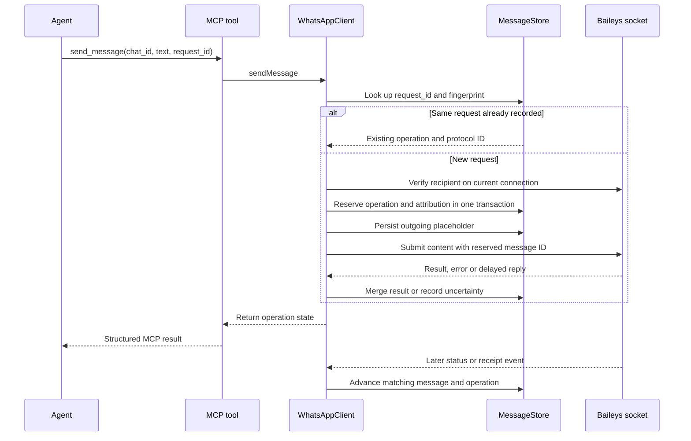

# Low-level design

The public interface is a set of MCP tools. The daemon creates an MCP server for each HTTP session and passes the same `WhatsAppClient` into each server. That shared instance owns the message store, active socket and send limits. A process-wide `CallService` coordinates the optional calling CLI. [Tool registration](../src/tools/register.ts)

## Entry points and contracts

| Entry point | What happens on a normal request |
| --- | --- |
| `scripts/setup.mjs` | Initializes private state, creates missing key and token files with exclusive creation, validates existing files, and creates the configured uploads directory. |
| `scripts/run.mjs --daemon` → `main()` | Resolves launcher defaults, takes the process lock, opens and migrates the message store, verifies tmpfs, binds HTTP, then starts the WhatsApp connection. `WHATSAPP_OFFLINE=true` skips automatic socket startup. |
| `scripts/run.mjs` → `startBridge()` | Reads the token and forwards MCP list and call requests to the configured loopback URL. Tool listing can reconnect after session expiry. A failed tool call returns the error to the caller. |
| `startHttpServer()` | Checks Host, Origin and bearer token. Initializes or resumes an MCP session, bounds the JSON request, then invokes the SDK transport. The default MCP route is `/mcp`. |
| `createMcpServer()` | Registers tool names, Zod argument schemas, annotations and handlers. A normal response has `ok`, `connection`, `source` and `data`. Service errors carry a code, message and retryable flag. |

The API token authenticates requests to health and transfer endpoints too. A session ID tells the SDK which MCP conversation a request belongs to. The daemon still checks the token on every request. [Launcher](../scripts/run.mjs) · [HTTP server](../src/http-server.ts) · [Schemas](../src/schemas/index.ts)

## Trace one text send

The caller's `request_id`, WhatsApp's `wa_id`, and SQLite's integer `message_id` serve different purposes. The first deduplicates an attempted send, the second identifies the protocol message within its chat and direction, and the third joins local rows. The content fingerprint detects conflicting reuse of a request ID. For a synthesized note, the fingerprint uses the chat, text and voice so generating a different sequence of audio bytes cannot turn the same request into a second send. [Send implementation](../src/services/whatsapp-client.ts)

Attribution is reserved once per logical operation. The first three reservations for a recipient use the full agent attribution. Later reservations use the short signature. Ordinary text or captioned media carries it directly. Audio and voice notes use a separate preceding text with a deterministic child request ID. An uncertain or failed prelude blocks the media submission. Inspect `watermark_request_id` when returned. [Send integration tests](../test/send-integration.test.mjs)

## Tables and message identity

| Table | Key or relationship | Purpose |
| --- | --- | --- |
| `chats`, `messages` | One chat has many messages through `chat_id` | Human-readable view of text, time, sender and message type. Triggers maintain chat counts and last activity. |
| `messages_fts` | FTS5 row ID equals `messages.message_id` | Indexes message text, sender name and chat name. Insert, update and delete triggers keep it in step with the underlying row. |
| `wa_protocol` | References one local message. Unique on `(jid, wa_id, from_me, participant)` | Stores the serialized envelope, media metadata, receipt state, and edit or deletion timestamps. Incoming group messages include the participant in the identity. |
| `wa_operations` | Primary key `request_id`, indexed by chat and WhatsApp ID | Stores content fingerprint, reserved protocol ID, operation kind, state, timestamps and optional error code. |
| `wa_receipts` | Chat, WhatsApp ID, direction, group sender and receipt recipient form the primary key | Stores recipient-specific evidence. Migration 5 preserves older receipts with unknown direction. The reader includes that evidence only when the chat and ID match a single message. |
| `wa_contacts`, `wa_lid_mappings` | Contact JID and linked-device identifier | Resolve known names and protocol-confirmed phone mappings. A numeric-looking `@lid` remains opaque until mapped. |
| `wa_attribution_counts`, `wa_meta`, `wa_migrations` | Per-chat count, metadata name and schema version respectively | Preserve attribution across restarts and track repairs or migrations. |

A **JID** is WhatsApp's chat or user address. When a partial receipt arrives, the store considers the supplied chat, direction and group participant. It applies the event only if it can establish the identity. For content retrieval, Baileys' retry callback reads an undeleted envelope for a unique matching key. Media downloads additionally require a recognized media payload. A local historical row may have a `db:` identifier and no recoverable envelope. [Message store](../src/services/message-store.ts)

A keyed revocation clears the payload and searchable message text in one transaction. If the revoke arrives first with a complete key, the store creates a deletion record immediately using the observation time. Later edits and history echoes preserve the deletion. Clearing an entire local chat has different archive semantics from receiving a keyed revocation. [Ingestion and deletion tests](../test/robustness.test.mjs)

## Operation and connection states

| Operation state | Evidence available to the caller |
| --- | --- |
| `submitted` | A local operation and WhatsApp ID were reserved. A dispatch may be in progress or have returned. |
| `acknowledged` | A server acknowledgement was observed. |
| `delivered`, `read` | Delivery or read evidence was observed. A group result can reflect a single recipient. |
| `unknown` | The process restarted with a submitted operation, the network timed out, or the send returned insufficient evidence. Query the original request ID. |
| `failed` | The ledger has a failure code. Check it and any attribution child before deciding how to proceed. |

The connection has a separate state machine. Opening a socket creates a generation number. Event listeners ignore superseded generations. A send waiting for a recipient lookup, conversion or attribution cannot dispatch through a new generation. A transient disconnect uses bounded reconnect attempts. Logout (401) and replacement (440) persist terminal reasons in the auth store. An explicit relink backs up credentials before resetting them and declines to run during active send or transfer work. [Socket lifecycle](../src/services/whatsapp-client.ts) · [Auth store](../src/services/auth-store.ts)

## Voice and media paths

- **Voice note.** `CallService.sendVoiceNote` validates the text and voice. `sendSynthesizedVoice` looks for an existing operation and verifies the recipient. Piper writes a private temporary WAV inside uploads. The file sender snapshots the opened input, converts to Ogg Opus, verifies the codec and dispatches with `ptt: true`. The synthesis directory is removed on success or failure. [Call service](../src/services/call-service.ts) · [File sender](../src/services/whatsapp-client.ts)
- **Live call.** `CallService.dial` starts the local CLI with individual arguments and a deadline. The CLI verifies the requested contact in WhatsApp Web and waits for call UI evidence. A visible duration indicates connection. Status, hangup and speech attach only to an existing calling page. The profile's `DevToolsActivePort` contains a port and browser instance path. Both must match the running browser before attachment. [Browser discovery](../calling/src/browser.ts) · [Call controls](../calling/src/call.ts)
- **Speech during a call.** After observing a connected call, the helper synthesizes a WAV with Piper and plays it through `WhatsAppVirtualSink`. A remapped PipeWire source named `WhatsAppVirtualMic` supplies that audio to the browser. The shell helper creates a private directory under `TMPDIR` or `/tmp` for this live-call WAV and cleans it on exit. End-to-end audibility and latency depend on the host and remote device. [Audio helper](../calling/scripts/whatsapp-audio-setup)
- **Transfers.** `POST /upload` accepts one multipart file of at most 50 MiB. `GET /download` serves a bounded regular file from the private roots. The daemon checks the opened file descriptor and rejects multiple hard links. Inline MCP media retrieval is limited to 4 MiB decoded. Every ten minutes the running daemon attempts to remove top-level upload and download files older than one hour. [HTTP transfers and cleanup](../src/http-server.ts)

## Capacity and recovery

The HTTP layer admits up to 32 MCP sessions, 64 concurrent requests and two HTTP transfers. The client separately admits four logical sends and two media transfers. A timed-out network promise retains its send slot until it settles. Idle MCP sessions normally expire after 15 minutes. Busy tool requests can finish before session expiry. [HTTP limits](../src/http-server.ts) · [Send admission tests](../test/send-integration.test.mjs)

The message and auth databases use SQLCipher-compatible encryption, WAL and synchronous transactions. Backups serialize a database and wrap it with AES-256-GCM. The restore script authenticates the backup, re-encrypts temporary pages on tmpfs, and writes a new encrypted destination. A backup belongs to one database and requires its original key. The operator protects that key and decides when to restore. [Encrypted database](../src/services/encrypted-db.ts) · [Recovery procedure](../SECURITY.md)

Run the walkthrough for a small, reproducible example of protocol identity, search and revocation. [Walkthrough](how-it-works.md)
